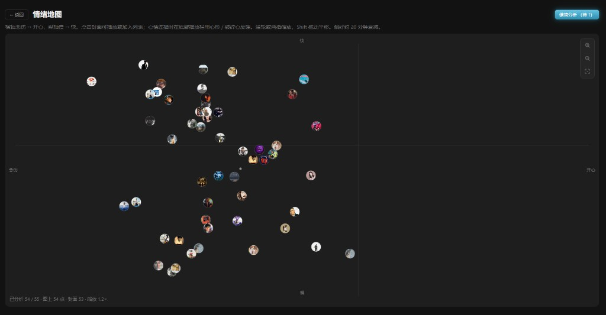
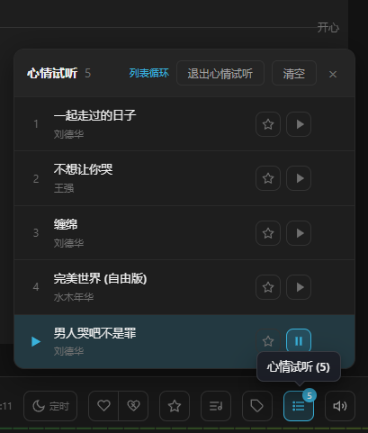
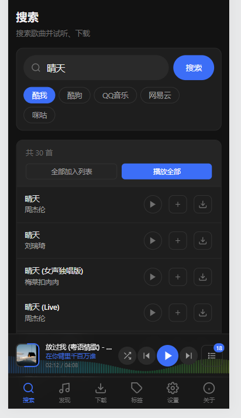

# 柠檬音乐 · Lemon Music

[](LICENSE)
[](https://github.com/jia070310/lemon-muisc/releases)

面向飞牛 NAS、Docker 与自托管的 **Web 音乐工具**：本地音乐库、标签整理、试听播放，并兼容落雪（LX Music）、澜音、MusicFree、BakaMusic 音源插件。浏览器内完成「找歌 → 试听 → 下载 → 整理」。

> **空壳软件，不内置任何在线音源与版权曲库。**  
> 搜歌 / 试听 / 下载依赖你自行导入的兼容音源脚本；未导入时仍可使用本地曲库、标签、播放等本地能力。基于落雪音乐修改，与落雪桌面版无官方从属关系。

当前版本见 [Releases](https://github.com/jia070310/lemon-muisc/releases) · 开源协议：**[MIT](LICENSE)**  
飞牛应用中心显示名：**柠檬音乐**（浏览器标题可为「柠檬音乐下载」）  
仓库：[https://github.com/jia070310/lemon-muisc](https://github.com/jia070310/lemon-muisc)

| 部署方式 | 说明 |
|----------|------|
| **飞牛 FPK** | 原生应用，运行时依赖应用中心 **Node.js v22**（有系统证书时自动 HTTPS） |
| **FnDepot 外部源** | 添加仓库地址即可安装/自动更新：`https://github.com/jia070310/lemon-muisc`（需 FnDepot ≥ 0.0.7） |
| **Docker / 服务器** | 拉镜像即可，见 [docs/docker.md](docs/docker.md) |
| **开放 API** | [docs/open-api.md](docs/open-api.md) · 本机 `http://<主机>:7983/api/docs` · [OpenAPI](docs/openapi.yaml) |
| **上架介绍文案** | [docs/store-app-intro.md](docs/store-app-intro.md) |

QQ 互动群「飞牛柠檬🍋muisc」（群号 **1126326017**）  


---

## 界面预览

日常主流程：**搜索 / 发现 → 试听下载 → 音乐库 / 文件管理整理**。截图清单见 [docs/screenshots/README-SCREENSHOTS.md](docs/screenshots/README-SCREENSHOTS.md)。

### 应用介绍主图

| 每日推荐 | 搜索 | 文件管理 |
|----------|------|----------|
|  |  |  |

| 全屏歌词 | 风格样式 |
|----------|----------|
|  |  |

### 情绪地图 · 心情试听

分析本地音乐后，在坐标图上找歌；点封面进入独立心情队列。





### 发现 · 下载 · 标签


| 查重 | 备份 | 睡眠定时 | 手机端 |
|------|------|----------|--------|
|  |  |  |  |

> 请仅用于个人已合法授权的音乐资源管理。请遵守当地法律法规及各平台服务条款，不要将本项目用于侵权或商业用途。

---

## 功能概览

### 音源与定位

- **不内置音源**：需在「设置 → 音源管理」自行导入兼容脚本并启用（落雪 / 澜音 / MusicFree / BakaMusic）
- 可同时启用多个音源；各用户可独立开关；合集类插件可按平台单独开关
- 未配置音源时：本地扫描、播放、标签、清理、整理等仍可用

### 搜索

- 通过已激活音源检索（常见脚本可覆盖酷我、酷狗、QQ、网易云、咪咕；亦可导入汽水、B站、喜马拉雅等）
- 按关键词分页搜索 **歌曲 / 专辑 / 歌单**
- 单曲试听、加入试听列表、选音质下载；多选批量下载
- 歌单结果可浏览曲目、批量下载，或 **导入到音乐库歌单**

### 发现

- 粘贴歌单链接或 ID，解析完整曲目列表
- 推荐歌单、排行榜、新歌 / 新碟（依赖音源能力）
- 试听、下载、收藏、加入歌单；可一键保存为音乐库网络歌单

### 试听与播放

- 底栏播放器：播放控制、进度、音量；试听列表持久化（列表循环 / 单曲循环）
- **全屏播放**：大封面、逐行 / 逐字歌词、频谱；滚动后空闲回当前句
- **情绪地图 / 心情试听**：本地曲情绪坐标；独立心情队列；心形喜欢 / 碎心跳过
- 试听短片段时可跨音源 / 平台补源；睡眠定时；桌面 / 手机自适应
- 本地 WAV 可直播；APE 等需主机 **ffmpeg** 转码后再播
- 弱网 / 车机可选本地转码流畅播放；局域网访问时可对本地曲直出原文件

### 下载

- 任务队列 + WebSocket 进度；失败分类与重试
- 音质按曲目真实可用档展示（含 FLAC / Hi-Res / 母带等，有则可选）；菜单旁体积来自音源元数据，仅供参考
- **假无损校验**：取链后若文件头不是所选无损格式（实为 MP3 / M4A 等），会拒绝保存并换源或按策略降档。因此可能出现「菜单写约 200MB 母带，落盘只有几十 MB 普通 FLAC」——并非体积算错或母带被压小，而是该档链接不可用 / 假无损后落到可用档。需要指定档位时可选用「不降档」以便失败时明确提示
- 路径、文件名格式、并发、同名策略、按歌手 / 专辑分组（避免「未知专辑」空目录等）
- 内嵌封面 / 歌词与文本标签（歌名、歌手、专辑、专辑艺术家、年份、风格等）
- 歌单循序下载、分批与间隔；可选按歌单建文件夹

### 音乐库

- 扫描「设置 → 文件路径」中的音乐库目录：歌曲、专辑、歌手、风格
- 每日推荐（本地 + 平台混搭，需音源）、推荐歌单、漫游播放
- 智能歌单：最新添加、最近播放、收藏（歌曲 / 专辑 / 歌手）；自定义歌单
- 复制网络歌单、同步本地标识；网络歌单可按间隔检查更新
- 热更新：后台监测与进入库增量检查（可关，减轻低性能 NAS 压力）
- 路径权限：管理员可为用户指定管理员路径 / 专属路径 / 允许自选

### 文件管理

- **标签编辑**：批量改 MP3 / FLAC / WAV / APE / M4A 等；匹配缺失、按文件名重设、手动检测、网络补全
- **清理**：重复曲目去重；按自定义大小阈值清理小文件（试听片段等）；支持版本变体归组
- **整理**：按歌手 / 专辑迁移到目标目录；伪 FLAC 检测；整理后刷新音乐库
- **音质升级**：按库内格式筛选并循序升到目标无损档（覆盖原文件，需音源）

### 设置

| 模块 | 内容 |
|------|------|
| **文件路径** | 音乐库目录（可多路径）；下载共享目录 + 可选个人目录 |
| **音源管理** | 导入脚本、启用开关、健康度、标签匹配并发、平台解析开关 |
| **风格样式** | 主题、配色、封面样式、可视化、歌词颜色、音乐库列数 |
| **试听下载** | 试听音质、跨平台补源、流畅播放 / 本地转码；下载与内嵌选项 |
| **账号管理** | 资料、改密、备份导入导出；管理员管用户与路径权限 |
| **关于** | 版本检测、Release / FPK 更新说明、互动群 |

### 飞牛 NAS

- 原生 **FPK**，不依赖 Docker；默认端口 **7983**
- 依赖应用中心 **Node.js v22**；安装向导填写绝对路径即可
- 有系统证书时应用内自动 HTTPS；桌面入口跟随飞牛当前协议
- 卸载可选保留配置，不删除用户音乐文件

---

## 技术栈

| 部分 | 说明 |
|------|------|
| 前端 | Vue 3 + Vue Router + Vite |
| 后端 | Node.js 20+、Express 5、WebSocket |
| 数据 | better-sqlite3 |
| 标签 | node-id3、music-metadata |
| 可视化 | Web Audio API + Canvas |
| 飞牛 | 原生 FPK + 商店 Node.js v22 |
| 服务器 | Docker（[docs/docker.md](docs/docker.md)）或 `npm start` |

---

## 快速开始（本地开发）

需要 [Node.js](https://nodejs.org/) 20 或以上。

```bash
git clone https://github.com/jia070310/lemon-muisc.git
cd lemon-muisc
npm install
npm run dev
```

| 地址 | 作用 |
|------|------|
| http://localhost:5174 | Vite 开发前端 |
| http://localhost:7983 | Express 后端 |

生产模式：

```bash
npm run build
npm start
```

### 首次使用

1. 默认账号 `admin123` / `admin123` 登录后立即修改用户名和密码  
2. **设置 → 音源管理**：自行导入并启用兼容脚本（本仓库不提供音源）  
3. **设置 → 文件路径**：添加音乐库与下载目录  
4. 在 **搜索 / 发现** 找歌（需音源），或在 **音乐库 / 文件管理** 整理本地文件  

---

## 账号与恢复

用户数据在配置目录下的 SQLite：

| 环境 | 路径 |
|------|------|
| 本地开发（默认） | `config/lx-music.db` |
| 飞牛 NAS（示例） | `/vol1/@appdata/lemon-music/config/lx-music.db` |

相关表：`users`、`sessions`、`user_settings` 等。

### HTTPS

| 部署 | 行为 |
|------|------|
| **飞牛 FPK** | 有系统证书则自动 HTTPS；`HTTPS=0` 可强制 HTTP |
| **Docker / 服务器** | 默认 HTTP；挂载证书并设 `SSL_CERT` / `SSL_KEY`。见 [docs/docker.md](docs/docker.md) |

### Docker 快速启动

拉镜像部署，不必 clone、不必 `--build`。把下面保存为 `docker-compose.yml` 后执行 `docker compose up -d`。完整说明见 [docs/docker.md](docs/docker.md)。

```yaml
services:
  lemon-music: # 服务名，一般不用改
    image: ghcr.io/jia070310/lemon-muisc:latest # 镜像；国内可改 ghcr.1ms.run/jia070310/lemon-muisc:latest
    container_name: lemon-music # 容器名
    ports:
      - "7983:7983" # 宿主机端口:容器端口，改左边即可
    restart: unless-stopped # 异常退出后自动重启
    environment:
      PORT: "7983" # 容器内监听端口，需与上面 ports 右侧一致
      DOWNLOAD_PATH: /downloads # 容器内下载目录
      CONFIG_PATH: /config # 容器内配置与数据库目录
    volumes:
      - ./data/music:/music # 音乐库：左边改成你的歌曲目录
      - ./data/downloads:/downloads # 下载保存目录
      - ./data/config:/config # 配置与数据库，更新镜像不要删
```

或：

```bash
docker pull ghcr.io/jia070310/lemon-muisc:latest
docker run -d --name lemon-music --restart unless-stopped -p 7983:7983 \
  -e PORT=7983 -e DOWNLOAD_PATH=/downloads -e CONFIG_PATH=/config \
  -v "$PWD/data/music:/music" -v "$PWD/data/downloads:/downloads" -v "$PWD/data/config:/config" \
  ghcr.io/jia070310/lemon-muisc:latest
```

国内拉不动 `ghcr.io` 时，把 `image` 换成 `ghcr.1ms.run/jia070310/lemon-muisc:latest`（步骤见 [docs/docker.md](docs/docker.md)「国内源拉取」）。

**宝塔面板**：镜像在 ghcr.io，请用「命令拉取」；默认目录 `/www/wwwroot/lemon-music/{config,music,downloads}`。步骤见 [docs/docker.md](docs/docker.md)「方式四：宝塔面板 Docker」。

启用 HTTPS（证书放到 `certs/`）：

```bash
docker compose -f docker-compose.yml -f docker-compose.https.yml up -d
```

### 忘记密码

只改登录密码，不清空歌单 / 收藏 / 音乐文件。飞牛请用商店 **Node.js v22**，不要用 `npm`：

```bash
PATH=/var/apps/nodejs_v22/target/bin:$PATH CONFIG_PATH=/vol1/@appdata/lemon-music/config node /var/apps/lemon-music/target/scripts/reset-password.js --list

PATH=/var/apps/nodejs_v22/target/bin:$PATH CONFIG_PATH=/vol1/@appdata/lemon-music/config node /var/apps/lemon-music/target/scripts/reset-password.js 用户名 新密码
```

配置在 **`@appdata`**，不是 `@appconf`。本地源码可用：

```bash
npm run auth:reset-password -- --list
npm run auth:reset-password -- 用户名 新密码
```

### 清空所有用户

会重新生成默认管理员 `admin123` / `admin123`，不清全局音源 / 路径 / 下载任务：

```bash
# 本地源码
npm run auth:reset-users -- --yes

# 飞牛
PATH=/var/apps/nodejs_v22/target/bin:$PATH CONFIG_PATH=/vol1/@appdata/lemon-music/config node /var/apps/lemon-music/target/scripts/reset-users.js --yes
```

---

## 飞牛 NAS（FPK）

```powershell
npm run fpk:build
```

生成 `fpk/lemon-music-<版本>-x86.fpk` 与 `-arm.fpk`（版本以 `fpk/manifest` 为准）。说明见 [docs/fpk-install.md](docs/fpk-install.md)。

本机打包并上传 GitHub Release：

```powershell
npm run fpk:publish
```

发布成功后会同步更新仓库根目录 [`fnpack.json`](fnpack.json)（FnDepot V2）。飞牛侧用 **FnDepot ≥ 0.0.7** 添加外部源：

```
https://github.com/jia070310/lemon-muisc
```

即可在应用源中安装 **柠檬音乐**，并随 Releases 自动检查更新（x86 / arm 分架构包）。

---

## 常用脚本

| 命令 | 说明 |
|------|------|
| `npm run dev` | 前后端开发服务 |
| `npm run build` | 构建前端到 `dist/public` |
| `npm run start` | 启动后端 |
| `npm run openapi:build` | 重新生成 OpenAPI 规格 |
| `npm run auth:reset-password` | 本地重置密码（飞牛见上文 `node ...`） |
| `npm run auth:reset-users -- --yes` | 本地清空用户并初始化 |
| `npm run fpk:build` | 打包原生 FPK |
| `npm run fpk:publish` | 打包并上传 GitHub Release |

---

## 文档与版本

- 版本发布与变更说明：[Releases](https://github.com/jia070310/lemon-muisc/releases) · [docs/RELEASE-NOTES.md](docs/RELEASE-NOTES.md)
- 截图清单：[docs/screenshots/README-SCREENSHOTS.md](docs/screenshots/README-SCREENSHOTS.md)
- Docker：[docs/docker.md](docs/docker.md) · 开放 API：[docs/open-api.md](docs/open-api.md)
- 应用内 **关于** 页可检测 GitHub 最新 Release

---

## 致谢与声明

- 音源脚本需自行准备，**本仓库不内置任何第三方平台音源**。
- 项目定位为 NAS / 自托管上的个人音乐整理与播放工具；基于落雪音乐修改，无官方从属关系。
- 社区贡献致谢：[@theroad](https://github.com/theroad)（[#18](https://github.com/jia070310/lemon-muisc/pull/18)）等。
- 仅供个人合法使用。请确保你对所管理的音乐拥有相应权利，并遵守当地法律与各平台条款。

## License

本项目采用 [MIT License](LICENSE)。
